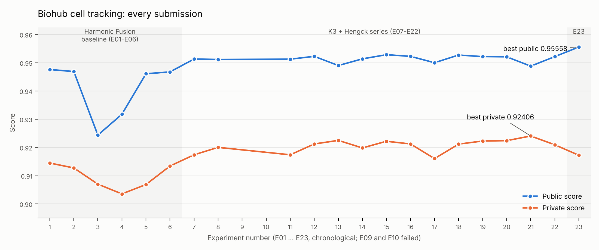
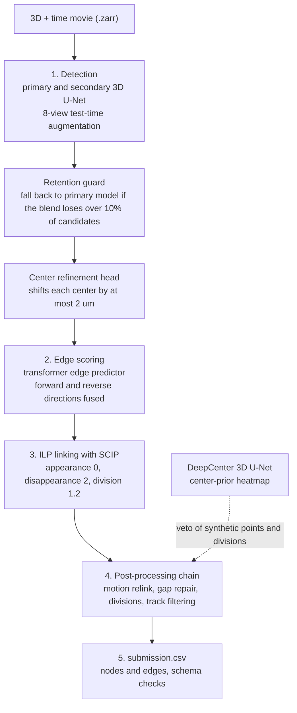
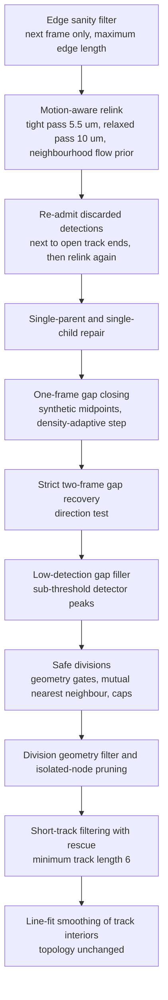

# Biohub: Cell Tracking During Development

 

My work on the Kaggle competition
[Biohub - Cell Tracking During Development](https://www.kaggle.com/competitions/biohub-cell-tracking-during-development):
detect zebrafish cells in 3D time-lapse microscopy, link them across frames and find cell divisions, so that
whole cell lineages can be reconstructed automatically.
Final result: **bronze medal, 252nd of 3,947 teams**.

This repository documents the 23 submissions I made: the key notebooks, a full description of the pipeline,
and a log of every experiment with the hypothesis it tested and the exact code change against its parent.

**Contents**
[The task](#the-task) -
[Results](#results) -
[Pipeline overview](#pipeline-overview) -
[Pipeline stages in detail](#pipeline-stages-in-detail) -
[Key parameters](#key-parameters) -
[How the solution evolved](#how-the-solution-evolved) -
[Repository layout](#repository-layout) -
[Reproducing](#reproducing) -
[Credits and notes](#credits-and-notes)

## The task

- **Input:** 3D + time microscopy movies stored as `.zarr` (voxel size z = 1.625 um, y = x = 0.40625 um).
- **Output:** one `submission.csv` with two row types: *nodes* (a cell centre `t, z, y, x` in voxels) and
  *edges* (`source_id -> target_id`, a link of the same cell between consecutive frames). A **division** is a node
  with two outgoing edges.
- **Metric:** `score = adjusted_edge_jaccard + 0.1 * division_jaccard`.
  Predicted nodes are matched to ground-truth nodes per frame by optimal bipartite assignment (maximum distance 7 um);
  an edge counts as correct when both its endpoints match ground-truth nodes joined by a ground-truth edge.
  The edge Jaccard is penalised for predicting too many nodes. Ground truth is sparse, and the score can exceed 1.0.
- **Rules:** code competition. Everything runs in a Kaggle notebook (GPU, at most 12 hours, internet disabled).

## Results



| ID | Change | Public | Private | Comment |
|----|--------|-------:|--------:|---------|
| E01 | Harmonic Fusion baseline | 0.94762 | 0.91448 | first Harmonic Fusion submission |
| E03 | Hengck end-to-end linker only | 0.92437 | 0.90700 | a single end-to-end linker alone hurt badly |
| E06 | post-process, then Hengck gate | 0.94677 | 0.91342 | Hengck gate after post-processing recovers the loss |
| E07 | K3 + Hengck fork-transfer base | 0.95133 | 0.91740 | new base: K3 + Hengck fork transfer |
| E12 | motion-aware relink | 0.95228 | 0.92124 | motion-aware relink: +0.004 private over E07 |
| E15 | long-edge gate (>8.4 um) | 0.95286 | 0.92219 | best public among the relink ablations |
| E21 | secondary model weight 0.80 -> 0.50 | 0.94881 | 0.92406 | **best private score** |
| E23 | cached edge scores (Harmonic Fusion) | 0.95558 | 0.91724 | **best public score**, but private drops |

All 23 submissions are in [`experiments/results.csv`](experiments/results.csv) and are described one by one in
[`experiments/LOG.md`](experiments/LOG.md).

## Pipeline overview

The final pipeline (E23, `notebooks/06_...`) turns a raw movie into a lineage graph in five steps.
Detection and edge scoring are done by neural networks; linking is an integer linear program;
a long chain of rule-based repairs then fixes what the solver cannot see.



### Post-processing chain (step 4)

The order below is the order in which the functions are called for every movie.



## Pipeline stages in detail

### 0. Runtime: offline, patched at run time

Code-competition notebooks have no internet, so everything is installed from attached Kaggle datasets:
Python wheels are installed with `pip --no-index --no-deps`, the inference repository and the model weights come
from a "support pack" dataset, and every artifact is checked against a manifest with SHA-256 hashes.
Instead of forking the upstream inference script, the notebook **patches it at run time** with exact
string replacements. Each patch asserts that its anchor text occurs exactly once and that the patched file still
compiles, so a silent mismatch cannot happen (a lesson recorded in the notebook comments after a patch that
silently did nothing in one run). Prediction is sharded over up to two GPUs and the shards are merged afterwards.

### 1. Detection

- **Models.** A primary 3D U-Net with a transformer edge predictor (`unet_transformer`, 50 training epochs) and a
  secondary model trained from a different seed.
- **8-view test-time augmentation.** Every frame window is evaluated eight times: identity, three flips,
  two 90-degree rotations, a transpose and an anti-transpose in the x-y plane. Each view is mapped back and the
  logits are averaged.
- **Dual-seed blend.** Detector logits are `(1 - w) * primary + w * secondary` with `w = 0.80`.
- **Retention guard.** For every frame the notebook counts the detections of the primary model alone and of the blend.
  If the blend keeps less than 90% of the primary candidates, that frame falls back to the primary model.
  Every decision is logged to `retention_guard_*.jsonl` and verified by a check at the end of the run.
- **Threshold.** Peaks are taken from the pooled logits with a detection threshold of 0.965.

### 1b. Center refinement head

A small regression head (`224 -> 32 -> 3`, SiLU) sits on top of the frozen U-Net features. For each detection it
samples the feature vector at the centre and at its six neighbouring voxels (neighbours as differences to the centre)
and predicts a bounded displacement of at most 2 um. According to the notes in the notebook, it was trained on a
capture of 20 training movies (4,136 detection-to-ground-truth pairs) and moved centres closer to the truth on
held-out movies (about 10% lower centre error, 16 of 20 movies improved). A hard check rejects any displacement larger than 2 um.

### 2. Edge scoring

For every pair of consecutive frames the transformer edge predictor scores all candidate links using
U-Net features sampled by trilinear interpolation at the detected centres.

- **Edge-feature TTA.** The features are accumulated over the same eight views, for the primary model and
  (with weight 0.75) for the secondary model.
- **Bidirectional fusion.** The model is also run in the reverse direction (target to source). The two score
  matrices are standardised and fused in probability space (`harmonic_probability`, weight 0.15).
  A link that both directions agree on is more trustworthy than one found by a single direction.

### 3. Linking as an integer linear program

Detections and candidate links form a graph (`tracksdata`). An ILP solved with SCIP chooses the links that maximise
the total edge probability while paying a cost for every track start (appearance weight 0), every track end
(disappearance weight 2) and every division (division weight 1.2). Each movie has a time limit of 1,200 s;
SCIP returns its best solution so far when the limit is hit.

### 4. Post-processing chain

Each step is conservative: it adds or changes only a small, capped number of elements, and most steps are
verified by the DeepCenter veto (below).

| Step | What it does |
|------|--------------|
| Motion-aware relink | Re-assigns links one-to-one per frame pair (Hungarian assignment). A *tight* pass (5.5 um) takes confident matches first; a *relaxed* pass (10 um) handles the rest. A **flow prior** estimates how the neighbours of a cell move (12 nearest neighbours within 40 um, at least 4 samples, the cell's own match excluded so a wrong link cannot vote for itself), so a cell that moves 8 um with its neighbourhood can still be matched correctly. |
| Re-admit detections | Detector peaks (score at least 0.965) that the ILP discarded but that sit within 4 um of an open track end or start are added back, then the relink runs again. |
| One-parent / one-child repair | Keeps the best incoming and outgoing link where the relink created conflicts. |
| One-frame gap closing | Bridges a track end and a track start that are one frame apart (within 5.0 um) by inserting a synthetic midpoint. The distance limit adapts to local cell density. The midpoint is refined and confirmed by the DeepCenter heatmap. |
| Strict gap-2 recovery | The same idea over two missing frames, with an additional direction test against the neighbouring track segments. |
| Low-detection gap filler | Bridges up to three missing frames along a straight line, using real sub-threshold detector peaks (score at least 0.5, within 3.5 um of the line) instead of invented points. The number of added nodes is capped at 3%. |
| Safe divisions | Adds a division only if every geometric gate passes: parent at most 9 um from the child, sisters at most 14 um apart, daughters moving apart (divergence at least 2.25 um), symmetric distances (tau 0.6), mutual nearest neighbours, and per-frame / global caps (0.76% / 0.375% of nodes). Divisions are additionally vetoed by DeepCenter. |
| Division filter, pruning | Drops divisions that violate the geometry limits and removes nodes without any link. |
| Short-track filtering | Removes connected components shorter than 6 frames (components containing a division are kept). A rescue rule restores short components with a high mean edge probability (at least 0.88) and a small mean edge length (at most 3 um), within a budget of 1.2% of nodes or 120 nodes. |
| Line-fit smoothing | Smooths node positions along straight track interiors without changing the graph topology. |

**DeepCenter veto.** A separate 3D U-Net predicts a "cell center" heatmap for the whole frame (with TTA).
Synthetic gap points and new divisions are accepted only where the heatmap supports a cell
(threshold 0.25). The veto is bypassed for tracks with strong, consistent motion and for points that coincide with a real detection.

**Cached edge scores (E23 only).** Candidate links whose model score is at least 0.10 are saved before the ILP and
passed to the relinker, so that it can choose links the ILP never saw. The cache is used only when its node IDs
match the solved graph; otherwise the original relinker of the 0.953 notebook stays in control (a deliberate fail-safe).

### 5. Output and safety checks

The submission is written in the competition format and then verified: exact column order, contiguous row IDs,
both row types present, every test movie present, and the retention-guard diagnostics complete for every frame.

### Held-out validator and post-processing sweep (E01-E06)

The early notebooks contain a re-implementation of the competition metric (7 um matching radius, node-count
penalty 0.1, division weight 0.1) that scores the pipeline on held-out *training* movies, sampled per movie type.
A sweep tried single changes (gap radius 4.5 um, tight radius 5.5 um, relaxed radius 9 um, learned-edge bonus 1.25,
gap-2 step 4.0 um, reuse radius 2.8 um, DeepCenter gap threshold 0.35) and kept a change only if the proxy score
improved by a margin while the edge Jaccard lost at most 0.0005. The validator costs about 11 minutes of GPU per run
and is switched off in the later notebooks.

## Key parameters

Everything is configured through `BIOHUB_*` environment variables at the top of each notebook.
Values of the final notebook (E23):

| Parameter | Value | Meaning |
|-----------|------:|---------|
| `DET_THRESHOLD` | 0.965 | detection threshold |
| `DUAL_SEED_MIN_CANDIDATE_RETENTION` | 0.90 | retention guard of the dual-seed blend |
| `BIDIRECTIONAL_EDGE_WEIGHT` | 0.15 | weight of the reverse-direction edge scores |
| `ILP_APPEARANCE_WEIGHT` / `DISAPPEARANCE` / `DIVISION` | 0 / 2 / 1.2 | ILP costs |
| `ILP_TIMEOUT_S` | 1200 | SCIP time limit per movie |
| `MOTION_RELINK_TIGHT_UM` | 5.5 | tight relink radius |
| `MOTION_RELINK_FLOW_K` / `RADIUS_UM` | 12 / 40 | neighbours and radius of the flow prior |
| `GAP_CLOSE_UM` | 5.0 | one-frame gap-closing radius |
| `GAPFILL_MAX_GAP` / `MIN_SCORE` | 3 / 0.5 | low-detection filler |
| `SAFE_DIV_MAX_UM` / `SISTER_MAX_UM` | 9 / 14 | division geometry gates |
| `SAFE_DIV_DIVERGE_UM` | 2.25 | minimum divergence of the daughters |
| `OUTPUT_MIN_TRACK_LEN` | 6 | minimum track length |
| `DEEPCENTER_GAP_THRESHOLD` | 0.25 | heatmap threshold of the veto |
| `CACHE_EDGE_THRESHOLD` | 0.10 | minimum score for a cached candidate edge |

## How the solution evolved

### Phase 1: Harmonic Fusion baseline (E01-E06)

The first phase is a detection-plus-ILP pipeline with dual temporal models, edge-feature TTA, DeepCenter vetoes and
geometry-validated divisions (**Harmonic Fusion**). E01 uses post-processing settings selected on held-out training movies,
and E02 adds an ILP-preserving residual motion relink.
Next, the linker was replaced the linker with Hengck's end-to-end cell-point detector (E03). That alone cost about 0.022 public score,
so the effect was isolated: first by switching post-processing stages off (E04), then by letting the new
linker only **correct** the baseline when it was clearly more confident (a *confidence gate*, E05):
add a link if its probability is at least 0.92 with a margin of 0.35, replace one only if the old link has probability
at most 0.55 and the new one wins by 0.55, at most 8.5 um away, and at most 0.5% of the links changed.
Running the post-processing first and the gate afterwards (E06) brought the score back to 0.947.

### Phase 2: K3 + Hengck and a series of ablations (E07-E22)

The second phase builds on a fixed copy of the Harmonic Fusion notebook (called **K3** in the code). Two child
processes run in sequence on the GPU: the frozen K3 pipeline and Hengck's end-to-end model (a 3-level U-Net with a
4-layer transformer). The K3 graph stays unchanged; Hengck's divisions (**forks**) are projected onto K3 nodes with a
mutual nearest-neighbour mapping (within 4.875 um) and appended only if they pass fixed geometry gates.
This "fork transfer" is the base of the phase (E07, public 0.95133). Every later notebook is a controlled
experiment with one hypothesis, stated at the top of the notebook and kept in [`experiments/LOG.md`](experiments/LOG.md).

Ablations around the motion-relink baseline E12 (score change relative to E12):

| ID | Change | Public | Private |
|----|--------|-------:|--------:|
| E13 | looser division gates (parent 9.5 um, sister 15 um, caps raised) | -0.00326 | +0.00126 |
| E14 | disable the strict 3-frame (gap-2) recovery | -0.00089 | -0.00141 |
| E15 | drop weak relaxed-pass relinks longer than 8.4 um | +0.00058 | +0.00095 |
| E16 | advisory endpoint repair, at most 48 added edges | 0 | 0 |
| E17 | disable one-frame synthetic gap closing | -0.00226 | -0.00517 |
| E18 | keep tracks of length 5 (default minimum is 6) | +0.00046 | -0.00006 |
| E19 | relaxed relink radius 10 -> 9 um | -0.00009 | +0.00104 |
| E20 | detector threshold 0.965 -> 0.960 | -0.00016 | +0.00117 |
| E21 | secondary-model share of detector logits 0.80 -> 0.50 | -0.00347 | +0.00282 |
| E22 | detector threshold 0.965 -> 0.970 | -0.00010 | -0.00029 |

What these runs show:

- **Gap closing is the most valuable repair.** Switching it off (E17) causes the largest private-score loss of the series (-0.005) and a clear public loss.
- **Public and private scores can move in opposite directions.** Reducing the secondary-model share (E21) and
  loosening the division gates (E13) lowered the public score and raised the private one.
- **Most knobs are in a flat region.** Threshold, radius and track-length changes (E15, E18-E20, E22) move the scores by
  about 0.001 or less, which is close to the noise between the two leaderboards.
- **The HOCT endpoint repair (E16) changed nothing**: its scores equal E12 exactly.
- Two attempts to add V1327 endpoint consensus or fragment recovery on top of the K3 + Hengck base (E09, E10) failed with an exception and produced no score.

### Phase 3: cached edge scores (E23)

The last experiment feeds model scores of links that the ILP did not select into the motion relinker (see above).
Built on the Harmonic Fusion 0.953 notebook, it produced the best public score of the project (0.95558, +0.0033 over E12),
but a lower private score than E12 (0.91724 versus 0.92124), so the gain did not carry over.

## Repository layout

```
notebooks/      key notebooks, outputs stripped (Kaggle notebooks, GPU, internet off)
experiments/
  LOG.md        every experiment: hypothesis, result, diff against its parent
  results.csv   scores of all 23 submissions
assets/         figures
```

| Notebook | Experiment |
|----------|------------|
| `01_harmonic_fusion_baseline_v1.ipynb` | E01, first baseline |
| `02_harmonic_fusion_hengck_gate_v6.ipynb` | E06, best of the first phase |
| `03_k3_hengck_base_951.ipynb` | E07, base of the second phase |
| `04_k3_hengck_motion_relink_952.ipynb` | E12, motion relink |
| `05_k3_hengck_secondary_det_050_best_private.ipynb` | E21, best private score |
| `06_harmonic_fusion_edge_cache_best_public.ipynb` | E23, best public score |

The notebooks of phase 2 are short launchers: the whole pipeline is embedded as a `FILES` dictionary
(plus the frozen K3 cells as `k3_cells.json`) and unpacked to a temporary directory at run time,
with a SHA-256 hash check for every file.

## Reproducing

The notebooks run only on Kaggle: they read the competition data and third-party model datasets from
`/kaggle/input` and need a GPU (T4) with internet disabled.

1. Create a Kaggle notebook and attach the competition data plus the datasets listed under Credits.
2. Upload one of the notebooks from `notebooks/` and run it on a GPU accelerator.
3. Submit the resulting `submission.csv`.

## Credits and notes

- The pipeline builds on public Kaggle resources that are **not** included here:
  datasets by [pilkwang](https://www.kaggle.com/pilkwang) (`biohub-deepcenter-unet3d-center-prior-v1`,
  `biohub-temporal-unet3d-seed314159-v1`, `biohub-tracking-support-pack-50ep-v1`) and by
  [hengck23](https://www.kaggle.com/hengck23) (`hengck23-cell-point-detector-demo`), plus the
  `tracksdata` library. Respect their licenses and terms if you reuse them.
- The K3 notebooks embed the code of those upstream pipelines in their own `FILES` dictionary.
- Competition and metric by Biohub; see the competition page for the full citation.
